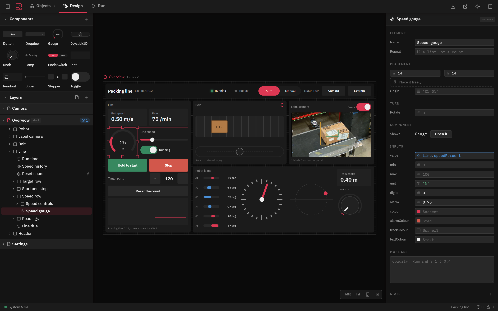
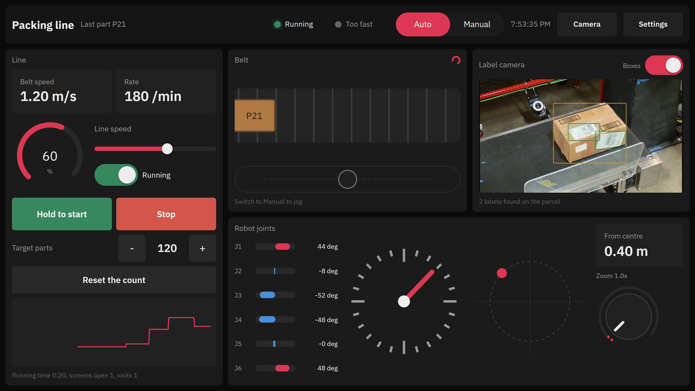

# Rant HMI

A GUI for designing safe, fast and powerful HMIs and apps easily. Design and deploy your user
interface in the web while the logic runs reliably in a native backend. Supports streaming
data over WebSocket or WebRTC.





## Install

```
rant install hmi
```

## Usage

```
rant run Hmi project=my-hmi    # a folder, made into a project when empty
```

Open http://localhost:6739 to design it, and http://localhost:6739/run on an operator's
screen.

## Build

```
cd client && npm install && npm run build && cd ..
cargo run -p rant-hmi -- path/to/my-hmi
cd app && npm install && npm run build && npx electron . ../path/to/my-hmi   # in a window of its own
```

## Example

A packing line with a belt, a robot and a label camera, run against a simulated line:

```
cargo run --example demo -- --loopback
cargo run -p rant-hmi -- examples/packing-line --loopback
```
