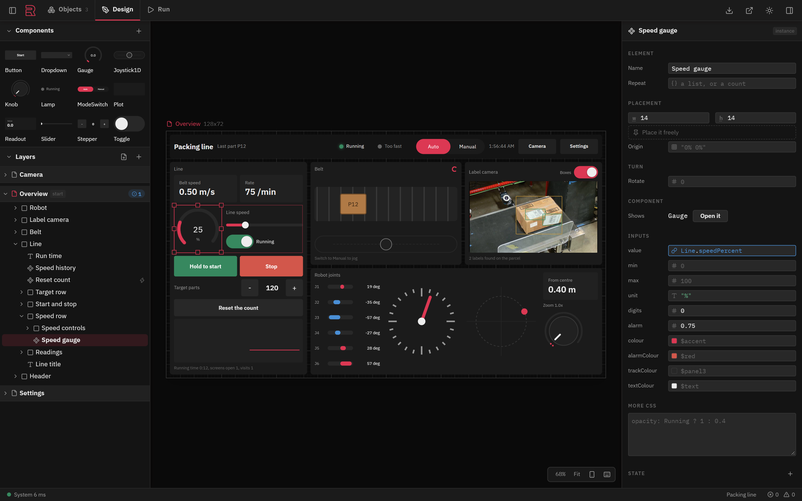
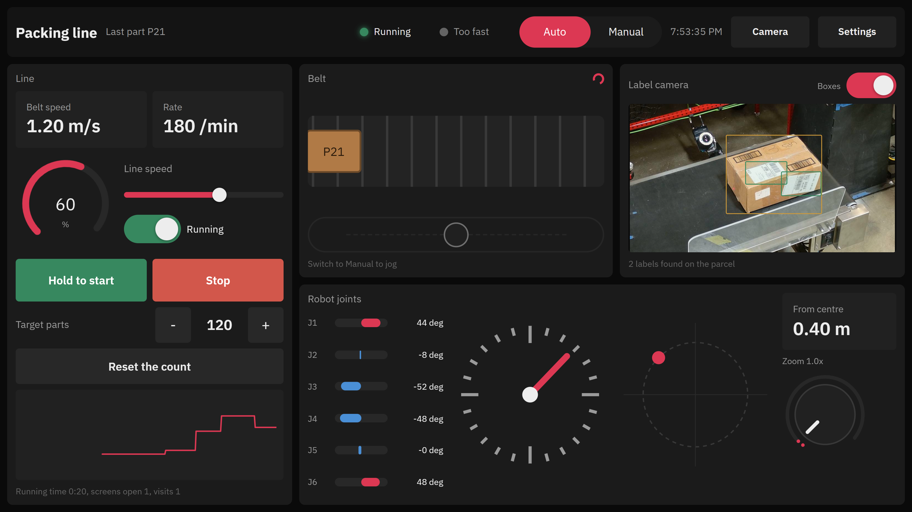

# Rant HMI

A GUI for designing safe, fast and powerful HMIs and apps easily. Design and deploy your user
interface in the web while the logic runs reliably in a native backend. Supports streaming
data over WebSocket or WebRTC.





```
rant install hmi
rant run Hmi project=my-hmi    # then open http://localhost:6739
```
